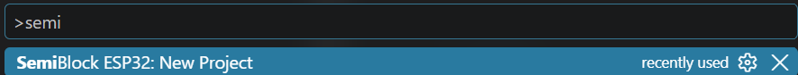
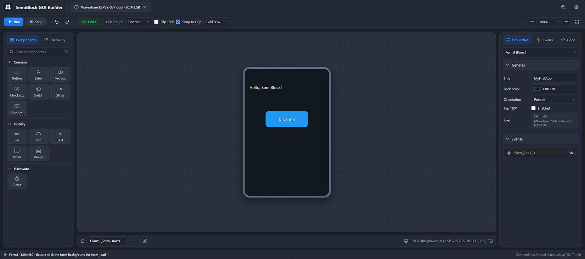
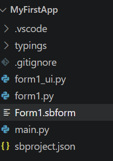

# Creating Your First Project

With your API key copied and ready, you can now initialise your very first SemiBlock ESP32 application directly within Visual Studio Code.

## Pre-requisites

* Both **SemiBlock ESP32** and **SemiBlock VSCode Extension** installed (see [Initial Setup in Visual Studio Code](./initial_setup_in_vscode.md)).

* A valid API key copied to your clipboard from [build.semiblock.ai](https://build.semiblock.ai) (see [Obtaining Your API Key](./getting_your_api_key.md)).

## Step-by-Step Guide

### Step 1: Open the Command Palette

1. Launch Visual Studio Code.

2. Open the Command Palette (Command Centre) by pressing `Ctrl+Shift+P` on Windows/Linux, or `Cmd+Shift+P` on macOS. Alternatively, click the search bar at the top of the window and type `>`.

### Step 2: Run the New Project Command

1. In the Command Palette, type `SemiBlock ESP32: New Project`.

2. Select **SemiBlock ESP32: New Project** from the dropdown list and press **Enter**.

> {width=inherit}

### Step 3: Enter Your API Key

1. A prompt window will appear at the top of Visual Studio Code asking for your API key.

2. Paste your copied API key into the input box and press **Enter**.

### Step 4: Choose a Project Folder

1. A file explorer dialogue window will open.

2. Navigate to your preferred directory, create or select an empty folder where you would like to store your application files, and click **Select Folder**.

3. Visual Studio Code will automatically generate the initial SemiBlock ESP32 project structure and open your workspace.

## Verifying Your Project Workspace

> {width=inherit}

Once the project is successfully created, you will see the generated project structure in the Visual Studio Code Explorer and the **SemiBlock GUI Builder** interface will launch automatically.

### 1. Project Folder Structure

> {width=inherit}

Inside your selected project folder, SemiBlock generates the following core files and directories:

* **`Form1.sbform`:** The visual form layout file. Opening this file launches the drag-and-drop SemiBlock GUI Builder.

* **`form1.py`:** Your primary MicroPython script for `Form1`, where you write custom application logic and event handlers (such as button clicks).

* **`form1_ui.py`:** Auto-generated UI layout code managed by the form designer. *(Avoid editing this file manually, as changes may be overwritten).*

* **`main.py`:** The entry point script executed when your ESP32 boots up.

* **`sbproject.json`:** The project configuration file storing hardware target settings and form references.

* **`typings/` & `.vscode/`:** Configuration folders providing MicroPython type hints, autocompletion, and workspace settings.

## Troubleshooting: Entered an Incorrect API Key?

If you accidentally enter an invalid or incorrect API key, you can easily reset it and try again:

1. Open the Command Palette (`Ctrl+Shift+P` or `Cmd+Shift+P`).

2. Type `SemiBlock ESP32: Remove API Key` and select the command from the list.

> {width=inherit}

3. Once the stored key has been cleared, run **SemiBlock ESP32: New Project** again and re-enter your valid API key when prompted.

## Next Steps

Now that your project workspace is set up, let us take a closer look at the visual designer tools and panels.

👉 **[Next: Familiarising Yourself with the GUI](familiar_with_the_gui.md)**