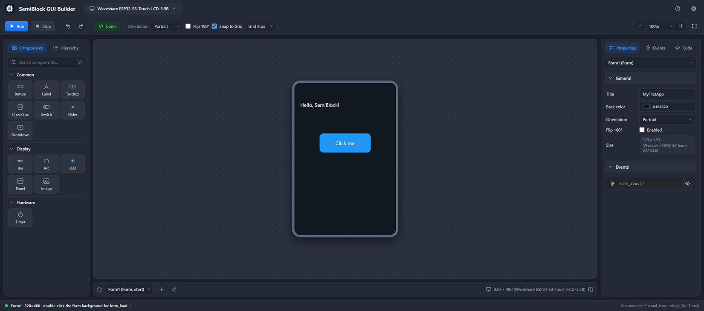

# Familiarising Yourself with the GUI

The **SemiBlock GUI Builder** provides an intuitive, visual workspace inside Visual Studio Code for designing user interfaces and linking them to MicroPython code. Understanding the layout of the builder will help you design screens efficiently.

## Workspace Overview

> {width=inherit}

When you open any `.sbform` file (such as `Form1.sbform`), the visual designer divides the screen into five primary areas:

1. **Top Toolbar**
2. **Left Sidebar (Components & Hierarchy)**
3. **Centre Design Canvas**
4. **Bottom Form Bar & Status Line**
5. **Right Inspector Panel (Properties, Events & Code)**

## 1. Top Toolbar

Located across the top of the editor, the toolbar provides quick access to execution controls, view modes, and canvas alignment tools:

* **Hardware Target Indicator:** Displays the active board profile (e.g., *Waveshare ESP32-S3-Touch-LCD-3.5B*).
* **Run & Stop:** Deploys your project to the connected ESP32 board and starts execution, or halts the running application.
* **Undo & Redo (`↶` / `↷`):** Reverts or reapplies recent visual layout changes on the canvas.
* **Code (`</> Code`):** Switches directly to the corresponding MicroPython script (e.g., `form1.py`) for the active form.
* **Orientation:** Toggles the screen layout between **Portrait** (`320 × 480`) and **Landscape** (`480 × 320`).
* **Flip 180°:** Rotates the display output by 180 degrees to accommodate inverted hardware mounting.
* **Snap to Grid:** Enables or disables magnetic grid alignment with configurable grid spacing (e.g., `Grid 8 px`) to keep controls neatly aligned.
* **Zoom Controls (`-` / `100%` / `+`):** Adjusts the magnification level of the design canvas.

## 2. Left Sidebar: Components & Hierarchy

The left panel houses all the building blocks for your interface across two tabs:

### Components Tab

Contains drag-and-drop controls organised into three functional categories (with a built-in search bar at the top):

* **Common:** Standard interactive elements including **Button**, **Label**, **TextBox**, **CheckBox**, **Switch**, **Slider**, and **Dropdown**.
* **Display:** Visual feedback and layout elements including **Bar** (progress bar), **Arc**, **LED**, **Panel**, and **Image**.
* **Hardware:** Non-visual system components such as **Timer** for scheduling periodic background tasks.

### Hierarchy Tab

Displays a structured tree view of all components placed on the current form, making it easy to select overlapping elements or review parent-child container relationships (such as controls placed inside a **Panel**).

## 3. Centre Design Canvas

The central area features a live, interactive representation of your ESP32 touchscreen:

* **Drag-and-Drop Placement:** Drag any control from the **Components** panel and drop it onto the screen preview.
* **Direct Manipulation:** Click any component on the canvas to select it, drag to reposition, or pull its corner and edge handles to resize.
* **Quick Event Binding:** Double-clicking a component (such as a **Button**) or the form background automatically generates its default event handler and opens the Python code editor at that exact function.

## 4. Bottom Form Bar & Status Line

Along the bottom edge of the workspace, you will find multi-form navigation and helpful context cues:

* **Form Switcher:** Displays the active form (e.g., `Form1 (Form, start)`) and allows you to switch between multiple screens in your project.
* **Add Form (`+`):** Creates a new `.sbform` screen in your project for multi-page applications.
* **Canvas Resolution & Hints:** Shows the exact pixel dimensions of the target screen alongside contextual tips (such as *"double-click the form background for form_load"*) and a live count of visual and non-visual components.

## 5. Right Inspector Panel: Properties, Events & Code

The right sidebar lets you fine-tune whichever component—or the base Form itself—is currently selected on the canvas:

* **Properties Tab:** Configure general settings such as component **Name**, **Title** or **Text**, **Back colour**, **Position (`X`, `Y`)**, **Size (`Width`, `Height`)**, and styling options.
* **Events Tab:** View and manage MicroPython event bindings (for example, `form_load()` for a Form, or `click(e)` for a Button). Clicking the `</>` icon jumps straight to that function in your `.py` file.
* **Code Tab:** Preview or inspect the generated code structure linked to the selected element.

## Next Steps

Now that you know your way around the SemiBlock GUI Builder, you are ready to build your first interactive feature by connecting UI controls to MicroPython events.

