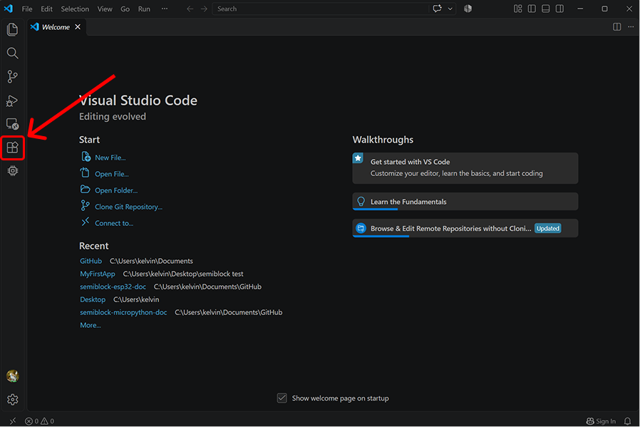
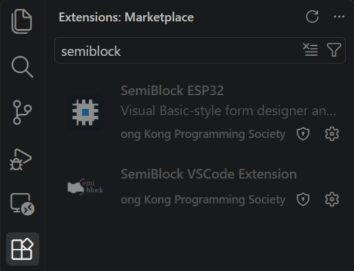

# Initial Setup in Visual Studio Code

Before you begin building graphical user interfaces for your ESP32 board, you must configure your Visual Studio Code environment by installing the two official SemiBlock extensions.

## Prerequisites

* **Visual Studio Code:** Ensure you have the latest version of [Visual Studio Code](https://code.visualstudio.com/) installed on your computer.
* **Internet Connection:** Required to download and install the extensions from the Visual Studio Code Marketplace.

## Installing the SemiBlock Extensions

Follow the steps below to locate and install both extensions published by the **Hong Kong Programming Society**:

### Step 1: Open the Extensions View

1. Launch Visual Studio Code.
2. Click the **Extensions** icon on the Activity Bar on the far left side of the window (or press `Ctrl+Shift+X` on Windows/Linux, `Cmd+Shift+X` on macOS).

> {width=inherit}

### Step 2: Search for SemiBlock

1. Click on the search bar at the top of the Extensions sidebar.
2. Type `semiblock` and press **Enter**.

> {width=inherit}

### Step 3: Install Both Required Extensions

In the search results, locate and install the following two extensions:

1. **SemiBlock ESP32**
   * **Publisher:** Hong Kong Programming Society
   * **Description:** Provides the Visual Basic-style form designer, component library, and MicroPython project tools for ESP32 hardware.
   * Click **Install**.

2. **SemiBlock VSCode Extension**
   * **Publisher:** Hong Kong Programming Society
   * **Description:** Provides core platform integration, account authentication, and workspace utilities required by the SemiBlock ecosystem.
   * Click **Install**.

## Verifying Your Installation

Once both installations are complete:

* Ensure neither extension displays a **Reload Required** button. If prompted, click **Reload** to restart Visual Studio Code.
* You are now ready to proceed with activating your API key and creating your first SemiBlock ESP32 project.

## Next Steps

Now that you have installed both extensions in Visual Studio Code, you are ready to obtain your API key to activate the platform.

👉 **[Next: Getting Your API Key](getting_your_api_key.md)**