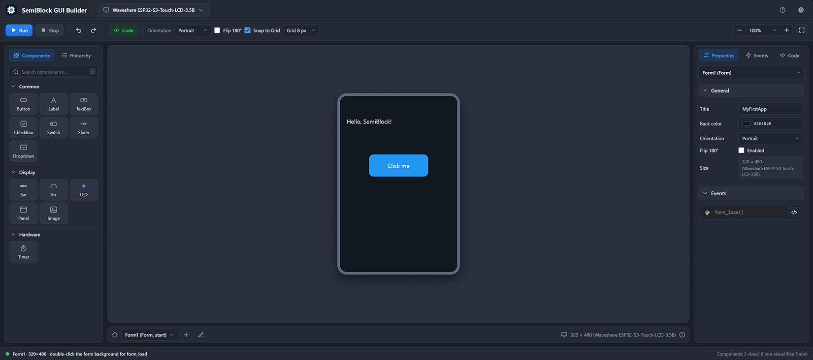

# SemiBlock ESP32 Extension: Overview

> {width=inherit}

Welcome to the **SemiBlock ESP32** Visual Studio Code extension documentation. SemiBlock ESP32 brings the intuitive, rapid application development experience reminiscent of classic Visual Basic to the powerful ESP32 microcontroller platform, empowering students, educators, and developers to build graphical user interfaces with ease using MicroPython.

## Introduction

SemiBlock ESP32 bridges the gap between hardware prototyping and graphical software design. By combining a drag-and-drop visual form designer directly within Visual Studio Code with structured MicroPython event handling, it removes the steep learning curve traditionally associated with embedded graphical displays.

---

## Key Features

### 1. Visual Form Designer
* **Drag-and-Drop Interface:** Effortlessly position user interface elements onto your screen workspace.
* **Rich Component Library:** Access a variety of standard controls, including buttons, labels, images, and dropdown menus.
* **Property Inspector:** Customise component attributes, such as dimensions, coordinates, text, and styling properties, in real-time.

### 2. Event-Driven MicroPython Development
* **Seamless Code Generation:** Double-clicking a visual component (such as a button) automatically generates and navigates to its corresponding event handler function in MicroPython (e.g., `btn1_click(e)`).
* **Type Hints & Autocompletion:** Benefit from built-in code assistance and type suggestions to write clean, maintainable firmware logic faster.

### 3. Multi-Form Management
* **Dynamic Navigation:** Easily design and switch between multiple forms or screens within a single project, enabling structured application flow for complex embedded systems.

### 4. Asset & Display Management
* **Image Resource Uploading:** Bundle and upload custom image assets directly to your device storage.
* **Orientation Controls:** Support for landscape and portrait display modes, alongside a 180-degree screen rotation toggle to suit various hardware enclosures.

---

## Hardware Compatibility

SemiBlock ESP32 is specifically optimised for modern touch-enabled display boards:
* **Primary Target:** Waveshare ESP32-S3-Touch-LCD-3.5B touchscreen hardware.
* **Display Integration:** Streamlined hardware abstraction ensures responsive touch input and smooth graphical rendering out of the box.

---

## Licensing and Authorisation

To unlock the full capabilities of the SemiBlock ESP32 extension within Visual Studio Code:
1. Register and manage your account via the official portal at [build.semiblock.ai](https://build.semiblock.ai).
2. Generate your unique API key.
3. Input the authorisation key into the extension settings in VS Code to activate your workspace.

---

## Summary

SemiBlock ESP32 transforms embedded development into a visual, approachable experience. Whether you are building educational prototypes or functional IoT control panels, it provides a robust, streamlined pathway from concept to deployment.